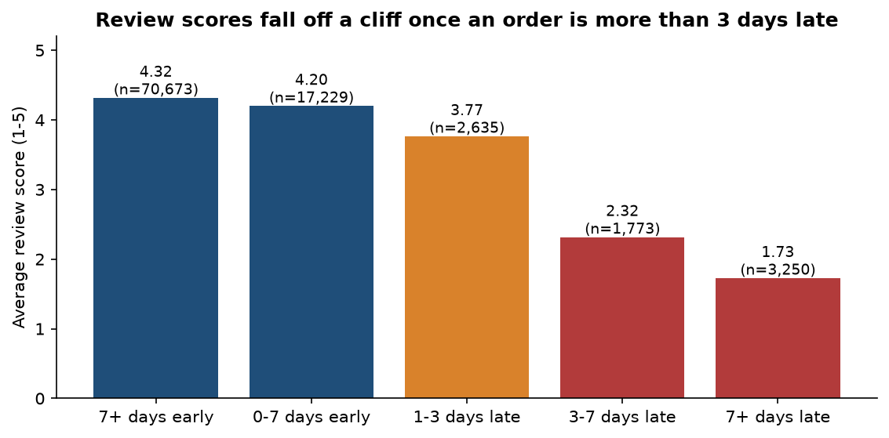
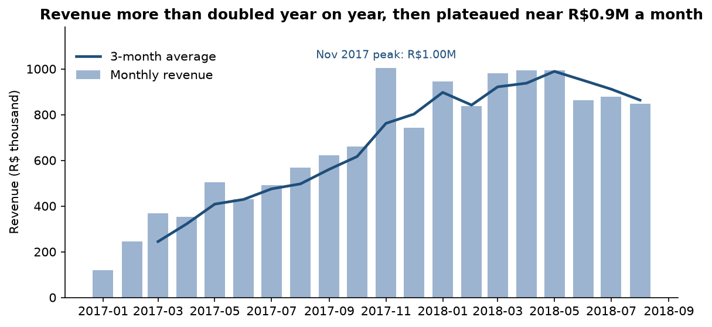
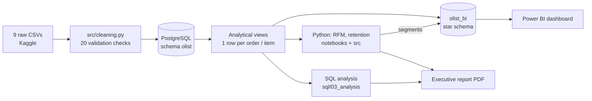

# Olist E-commerce: Business Intelligence and Customer Analytics

An end-to-end analysis of about 100,000 real orders from a Brazilian online marketplace: raw CSVs to a cleaned, validated **PostgreSQL** warehouse, **advanced SQL**, **Python** segmentation, a **Power BI** model and an **executive report** with sized recommendations. Everything rebuilds from the raw files with one command.

> **Read the result:** [`reports/Olist_Executive_Report.pdf`](reports/Olist_Executive_Report.pdf) (7 pages)  |  **Run it:** [`docs/RUN_GUIDE.md`](docs/RUN_GUIDE.md)  |  **Why each choice:** [`docs/decisions_log.md`](docs/decisions_log.md)

## What the analysis found

| Question | Answer |
|---|---|
| How does revenue evolve? | Jan-Aug 2018 revenue was **2.4x** the same months of 2017, driven by order volume (basket size flat at about R$137). Monthly revenue has **plateaued near R$0.9M** since January 2018. |
| Which categories matter? | **8 of 74 categories** deliver half of revenue and 18 deliver 80%. Sao Paulo, Rio and Minas Gerais are 63% of sales. |
| Delivery performance? | Median delivery 10.2 days, **8.1% late**. The carrier leg is about 80% of the time. The north/north-east is late 13.6% of the time (7.4% elsewhere), and late rates hit 14-21% at demand peaks. |
| Delay vs reviews? | Late orders average **2.57 stars vs 4.29** on time. Satisfaction collapses beyond 3 days late. |
| Which customers create value? | The top 10% of customers deliver 41% of revenue, and the big-spender segments (71% of revenue) are **all one-time buyers**. |
| Cohort behaviour? | **97% never reorder.** Only 1.9% reorder within 180 days, regardless of category, order value or payment type. Even doubling that adds under 1% to revenue. |




## Architecture



## Quick start

```powershell
git clone <your-repo-url>; cd olist-ecommerce-analytics
python -m venv .venv; .\.venv\Scripts\Activate.ps1
pip install -r requirements.txt
# put the 9 Kaggle CSVs in data/raw, create an empty database called olist,
# copy .env.example to .env and set your password, then:
python -m src.run_pipeline
```

About 90 seconds. Full step-by-step instructions, expected output and troubleshooting are in [`docs/RUN_GUIDE.md`](docs/RUN_GUIDE.md).

## Repository map

```
data/raw, data/clean      not committed (CC BY-NC-SA licensed, large)
src/                      cleaning.py, db_load.py, segmentation.py, make_figures.py,
                          build_report.py, run_pipeline.py (one-command build), config.py
sql/
  01_schema.sql           tables, PKs, FKs, checks, indexes
  02_load.sql             psql \copy alternative to src/db_load.py
  03_analysis/            00 views | 01 revenue | 02 categories | 03 delivery | 04 delay vs reviews
                          05 cohorts | 06 customer value | 07 data quality | 08 first-purchase drivers
  04_validation.sql       post-load reconciliation checks
  05_powerbi_model.sql    star schema (schema olist_bi) for Power BI
notebooks/                01 inspection, 02 cleaning, 04 segmentation and retention
dashboards/               BUILD_GUIDE.md, dax_measures.md, olist_theme.json, expected_values.md
reports/                  Olist_Executive_Report.pdf, figures/, dashboard_screenshots/
docs/                     RUN_GUIDE, decisions_log, data_dictionary, erd, analysis_findings,
                          phase4_findings, portfolio_notes
tests/                    unit tests (pytest)
```

## What this project demonstrates

| Skill | Evidence |
|---|---|
| Data cleaning and validation | `src/cleaning.py`: flags instead of deletes, 20 hard checks, every change counted in a log |
| Relational design | `sql/01_schema.sql` and `docs/erd.md`: keys at the true grain of each table |
| Advanced SQL | CTEs, window functions (`LAG`, `NTILE`, running totals), `PERCENTILE_CONT`, `FILTER`, cohort analysis |
| Analytical judgement | `docs/decisions_log.md`: 30+ decisions with the evidence behind each |
| Statistics | Confidence intervals and a chi-square test on retention drivers |
| Segmentation | RFM and a K-means cross-check that showed clustering added nothing |
| BI modelling | Star schema, DAX measures, reconciliation values to verify the dashboard |
| Communication | Executive report with sized, prioritised recommendations and stated limitations |
| Engineering | One-command reproducible pipeline, config via `.env`, unit tests |

## Data traps found and handled

- **`customer_id` is not a person.** Olist creates one per order. Using `customer_unique_id` is what reveals that 97% of customers buy once.
- **Join fan-out.** A naive items-to-payments join inflates revenue by 4.5% (R$14.21M instead of R$13.59M). All analysis aggregates first.
- **Incomplete edge months.** Analysis window is Jan 2017 to Aug 2018.
- **Delivery data is right-censored.** The latest months look faster only because slow orders had not arrived yet.
- **Same-day second orders** are split baskets, not loyalty, so they are excluded from the repeat definition.
- **Zip codes** read as numbers lose leading zeros and silently break joins.

## Limitations

Observational data: associations (such as delay and reviews) are not proof of cause. There is no marketing, pricing, cost or competitor data, so profitability and acquisition cost cannot be assessed. Impact sizes in the report are scenarios with stated assumptions. The Power BI file is built by hand from the guide in `dashboards/`; its DAX measures follow standard patterns but were written without access to Power BI Desktop, so reconcile them against `dashboards/expected_values.md`.

## Data and license

Data: [Brazilian E-Commerce Public Dataset by Olist](https://www.kaggle.com/datasets/olistbr/brazilian-ecommerce), CC BY-NC-SA 4.0. It is not redistributed here: download it from Kaggle. Code: MIT (see `LICENSE`).
