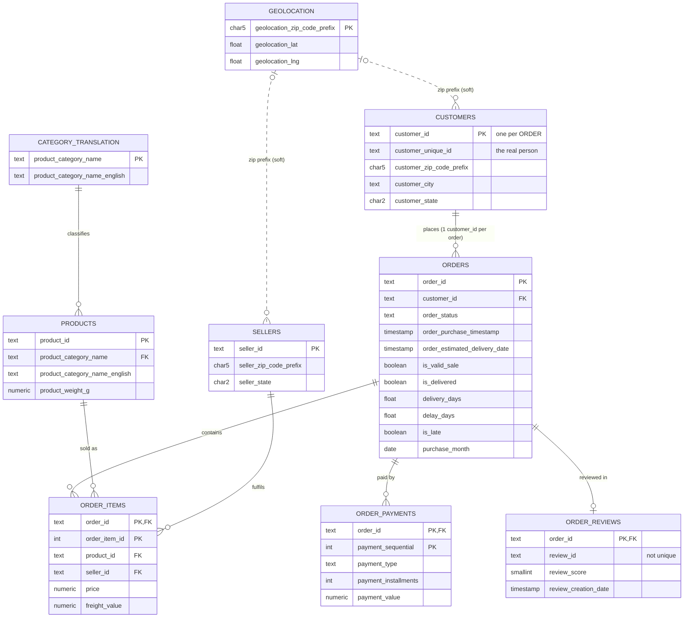

# Entity-relationship diagram

GitHub renders this diagram automatically. Solid lines are enforced foreign keys; dotted lines are soft joins (no FK, see note below).

## Modelling notes

- **Grain.** `orders` = 1 row per order. `order_items` = 1 row per item in an order. `order_payments` = 1 row per payment instalment/method. `order_reviews` = 1 row per order (after de-duplication).
- **The person is not `customer_id`.** `customers` has 99,441 rows but only 96,096 distinct `customer_unique_id`. Cohorts and RFM must group by `customer_unique_id`.
- **Why no FK to `geolocation`?** 279 customer and 7 seller zip prefixes have no coordinates, so an FK would reject valid rows. The zip join is optional, and map visuals simply skip those points.
- **Fan-out protection.** Analysis queries start from `vw_order_facts` (1 row per order) or `vw_item_facts` (1 row per item), never from raw multi-table joins.
